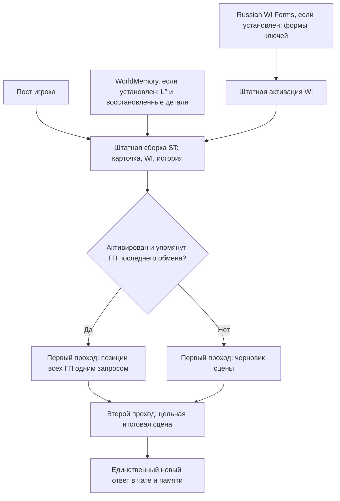

# Scene Director

Отдельное расширение SillyTavern для двухпроходной генерации игровой сцены. **Два полноценных RP-запроса вместо одного: выше задержка и расход входных токенов.** Это экспериментальный способ помочь диалогам и связности; улучшение качества на всех играх не доказано.

## Установка и модели

1. В менеджере расширений ST установите `https://github.com/Ilya626/Extension-SceneDirector` и перезагрузите страницу. Для ручной установки каталог — `SillyTavern/public/scripts/extensions/third-party/Extension-SceneDirector`.
2. Откройте **Расширения → Scene Director**. По умолчанию расширение выключено.
3. Выберите **подключение и модель первого прохода**, затем независимо **подключение и модель второго прохода**. Профили берутся из штатного Connection Manager ST. Ключи остаются в ST.
4. Оба поля моделей по умолчанию пустые: используется модель выбранного профиля либо текущая модель ST. Игрок подключает собственные эндпоинты и выбирает подходящие модели; встроенной модели или провайдера нет. Настройки reasoning берутся из подключения ST.
5. Включите **Два прохода для игровой сцены**.

Сейчас оба профиля должны использовать тот же тип Chat Completion API, что открытый чат. Например, два **Custom**-профиля с разными моделями/адресами. Переключение между типами Custom/OpenAI/Claude внутри одного хода не реализовано. Text Completion и групповые чаты не поддерживаются. Недоступный профиль или неподходящий режим дают ошибку, без скрытого переключения настроек ST.

## Как устроен ход

В редакторе нужной WI-записи отметьте **Главный персонаж**. Без отметки персонаж вторичный. Это самостоятельный флаг: он не меняет Constant, ключи или русские формы. Старые отметки WorldMemory автоматически в него не превращаются.

Кандидатами становятся только отмеченные ГП, чей профиль уже активировал ST, чей текст присутствует в собранном запросе и чьи ключи встретились в последнем обмене/текущем посте. Само упоминание не означает присутствия: первый проход должен исключить отсутствующего персонажа. Scene Director не форсирует активацию WI. Род, склонения и ручные формы обрабатывает отдельный Russian WI Forms; без него работают обычные ключи ST.

С ГП первый проход возвращает краткие позиции персонажей: установленные знания, отдельно предположения, ближайшую цель, умолчания, первую реакцию и необязательную реплику. Это предварительные писательские заметки, а не новые события или доказательства. Все ГП обрабатываются **одним запросом**, а не отдельным запросом на каждого. Второй проход получает исходный контекст и эти заметки. Без ГП используются черновик и редактор.

## Контекст и управление

- Оба прохода получают собранный ST/WorldMemory контекст. Scene Director не запускает повторную сборку WorldMemory и не обрезает её историю. Служебные инструкции и заметки добавляют токены сверх исходного запроса; размер зависит от токенизатора каждой модели.
- В чат, WI и архив не записываются черновик и позиции. Они также не добавляются в сохраняемый ST кэш itemized prompts. Поэтому штатный просмотр сохранённого промпта показывает исходную сборку, без этих временных дополнений. Отладочное логирование самого сервера/провайдера может содержать фактически отправленные данные.
- В панели видны этап, маршрут, модели и число начатых RP-запросов. Кнопка **Остановить** отменяет генерацию. При ошибке первого прохода расширение не продолжает скрытно в один проход и не делает автоматический платный повтор.
- При Stop/ошибке Regenerate прежний ответ восстанавливается, если пользователь тем временем не изменил чат. Частичный поток второго ответа обрабатывается штатным механизмом ST.
- Для двух RP-вызовов отключите tools, auto-continue, auto-swipe и `n > 1`. Фоновые вызовы резюмирования WorldMemory независимы и считаются отдельно.
- Лимиты выхода обоих запросов берутся из выбранного пресета подключения/ST. Для первого можно задать отдельное значение; `0` означает наследование. Если ваша модель расходует выход на reasoning, учитывайте это в её настройках. Промпт просит короткий служебный результат.
- Все четыре фактически используемые инструкции видны в **Инструкции обоих проходов**. Их можно независимо редактировать и сбрасывать. Промпты Summaryception не наследуются.

## Сочетания расширений

| Состав | Поведение |
| --- | --- |
| Scene Director | Два прохода поверх обычной карточки, native WI и истории ST |
| + WorldMemory | Использует уже восстановленную WorldMemory историю; в память идёт итоговый пост |
| + Russian WI Forms | Учитывает расширенные русские ключи активированных WI-профилей |
| Все три | Восстановление памяти, русские формы и два прохода остаются отдельными функциями |

Не включайте одновременно другой механизм, который тоже перехватывает игровой ответ для draft/edit или повторного вызова модели. Поддержку такого сочетания отдельно не проверяли.

## Проверено

На ST **1.19.0**, WorldMemory **0.5.10**, Russian WI Forms **0.1.6** выполнены четыре native-проверки: обе ветки/разные подключения и модели; полный контекст и только финальный ответ; Stop и ошибка Regenerate; сохранение WI-флага без изменения ключей/Constant/форм. **4/4 PASS**, с перехватом модельного backend до провайдера. Тестовые данные и локальный стенд не входят в поставку.

Дополнительно выполнена smoke-проверка двух проходов с реальным API. Это проверка исполнения, а не доказательство превосходства двух проходов. Автоматическое фоновое резюмирование во время native-проверок было приостановлено; его одновременная нагрузка отдельно не квалифицирована.

Continue реализован как дописывание суффикса, но отдельной native-квалификации пока не имеет. Телефонный прогон этого расширения пока не выполнен.

Лицензия: AGPL-3.0. Приватные карточки, чаты, API-ключи и ответы моделей не включены.
